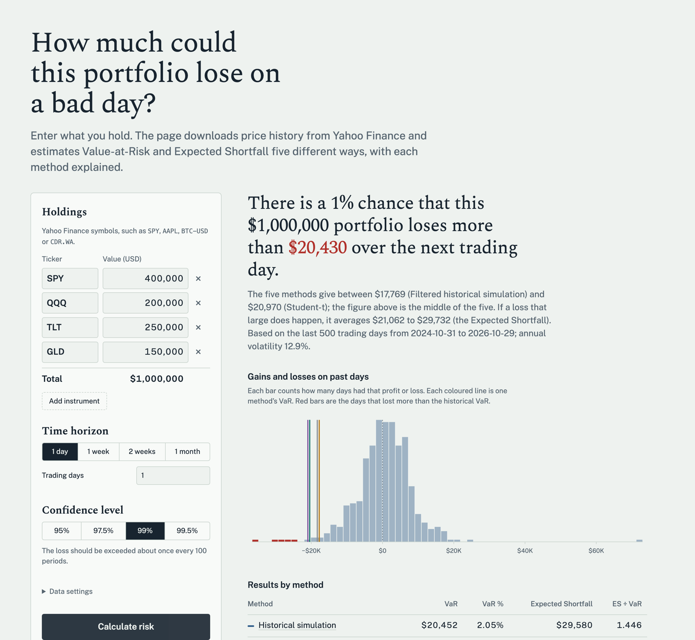

# Portfolio Tail Risk: VaR and Expected Shortfall, five ways


A local web app that answers one question: **how much could this portfolio lose on a bad day?**
You enter the instruments you hold and how much is in each, pick a time horizon and a confidence
level, and the app downloads price history and estimates **Value-at-Risk (VaR)** and
**Expected Shortfall (ES)** with five different methods. Each method is explained in plain
language next to its result.



## Run it

You need Python 3.12 or newer and an internet connection (for the price data).

```bash
git clone https://github.com/igazys/var-es-api.git
cd var-es-api
python3 -m venv .venv
source .venv/bin/activate          # Windows: .venv\Scripts\activate
pip install -r requirements.txt
uvicorn app.main:app
```

Then open **http://127.0.0.1:8000** in your browser.

With Docker instead:

```bash
docker build -t tail-risk .
docker run -p 127.0.0.1:8000:8000 tail-risk
```

## Privacy and safety

- **Only on your computer.** The server listens on `127.0.0.1`, so other devices on your
  network cannot reach it (the Docker command above keeps it that way).
- **Your amounts stay local.** The only data that leaves your machine is the list of ticker
  symbols and the start date, sent to Yahoo Finance to download public prices. Dollar amounts
  and results are never sent anywhere.
- **Nothing is stored.** No database, no accounts, no API keys, no tracking, and fonts are
  bundled with the app. Closing the server forgets your portfolio. (The `yfinance` library keeps
  a small cache of time-zone data and a Yahoo cookie in your user cache folder.)
- The optional API page at `/docs` loads its interface from the jsDelivr CDN.

## Using the page

1. **Holdings:** add each instrument by its Yahoo Finance symbol (`SPY`, `AAPL`, `BTC-USD`,
   `CDR.WA`, ...) and the dollar amount you hold. The total is the portfolio value.
2. **Time horizon:** 1 day, 1 week, 2 weeks, 1 month, or any number of trading days up to 250.
3. **Confidence level:** 95%, 97.5%, 99% or 99.5%. At 99%, VaR is the loss you expect to
   exceed on about 1 period in 100.
4. **Data settings** (optional): the first date to download prices from, and how many recent
   days of history the models use (default 500, about two years).

The results show:

- a one-sentence answer with the range of VaR across methods,
- a histogram of past gains and losses with each method's VaR drawn on it,
- a comparison table (VaR, ES, and the ES ÷ VaR ratio, a quick read on tail fatness),
- each holding's weight and volatility,
- for every method: how it works, what it assumes, and when it can mislead.

## The five methods

| Method | Idea |
|---|---|
| Historical simulation | Replays past days on today's portfolio and takes the empirical quantile of losses |
| Normal (variance–covariance) | Bell curve fitted to mean and volatility: VaR = z·σ − μ |
| Student-t | Fat-tailed t distribution; degrees of freedom fitted by MLE with the sample variance held fixed |
| Monte Carlo | 10,000 correlated multivariate-t scenarios at asset level (Cholesky factor of the covariance) |
| Filtered historical simulation | Past shocks rescaled to today's EWMA volatility (λ = 0.94, RiskMetrics) |

## API

The page is built on a small REST API, documented interactively at
**http://127.0.0.1:8000/docs** while the app runs.

| Method | Path | Purpose |
|---|---|---|
| GET | `/` | The web page |
| POST | `/var` | VaR and ES for every method |
| GET | `/health` | Liveness check |

```bash
curl -X POST http://127.0.0.1:8000/var \
  -H "Content-Type: application/json" \
  -d '{"tickers": ["SPY","TLT"], "values": [600000, 400000], "alpha": 0.99, "horizon_days": 5}'
```

| Field | Default | Notes |
|---|---|---|
| `values` *or* `weights` | one required | Dollar amount per asset, or weights that sum to 1 |
| `tickers` *or* `returns` | one required | Yahoo Finance symbols, or your own daily returns (rows = days) |
| `portfolio_value` | `1000000` | Used only with `weights` |
| `alpha` | `0.99` | Confidence level |
| `horizon_days` | `1` | Holding period, 1 to 250 trading days |
| `start` | `2018-01-01` | First date for downloaded prices |
| `window` | `500` | Lookback days (100 to 5000) |
| `methods` | all five | Which methods to run |

Invalid input returns `422` with an explanation; a failed price download returns `502`.
`example_client.py` shows how to call the API from Python.

## Tests

```bash
pip install -r requirements-dev.txt
pytest -q          # 21 tests, no internet needed
```

They check the maths against textbook values, the endpoints, the web page, and bad input.
GitHub Actions runs them on every push.

## Project structure

```
app/risk.py        the five estimators (pure maths, no web code)
app/main.py        FastAPI endpoints, validation, data download, caching
app/static/        the web page (HTML, CSS, plain JavaScript, no build step) and its fonts
tests/             pytest suite
example_client.py  calling the API from Python
Dockerfile         container image
```

## Design notes and limitations

- **Time horizon:** multi-day figures use the square-root-of-time rule (1-day estimate × √h).
  That assumes independent days and constant volatility, so it can understate risk when
  volatility clusters.
- **Student-t fit:** a free 3-parameter fit on ~500 days often lands near ν ≈ 2, which makes the
  variance nearly infinite and overstates VaR by up to 60%. The fit therefore matches the sample
  variance and estimates only ν, bounded to [3, 50]. A regression test covers this.
- **Data:** `yfinance` is an unofficial Yahoo Finance wrapper. Fine for research; a production
  system would use a licensed feed. Holdings are aligned on dates when all of them traded.
- **Positions:** long positions only, held at constant weights (daily rebalanced); returns are
  simple returns in each instrument's own currency.

## Possible extensions

Component VaR per asset · GARCH(1,1) filtering · stressed VaR
(2008, 2020 windows) · currency conversion for non-USD instruments

*Educational project, not investment advice.*
